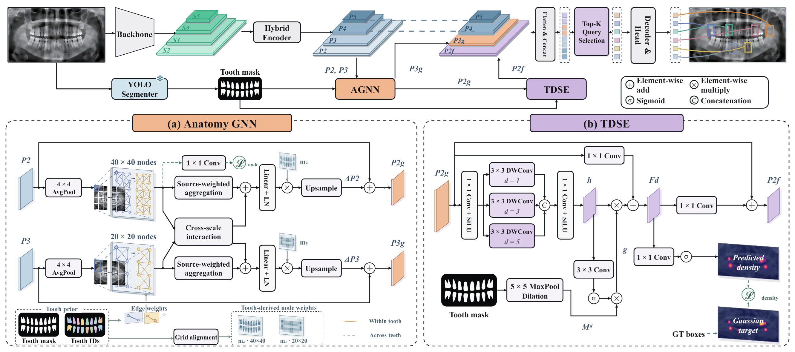

# GD-DETR

Implementation of **GD-DETR: Graph- and density-guided transformer for dental abnormality detection in panoramic radiographs**.

GD-DETR builds on RT-DETR and uses tooth-level anatomical priors to enhance feature representations. A frozen tooth instance segmenter generates tooth masks and instance maps. These priors guide graph-based feature interaction and tooth-guided density-supervised enhancement before detection.

---

## Highlights

- GD-DETR combines tooth-instance priors with lesion-density-guided features.
- Anatomy-guided propagation distinguishes within- and cross-tooth interactions.
- Density-supervised residual fusion enhances high-resolution detection features.
- GD-DETR reaches 74.2% AP on OralXrays-9 and 30.3% AP on DentalOPG.

---

## Framework

1. **Tooth prior generation**: A frozen YOLOv8n-seg segmenter produces a tooth mask and a per-tooth instance map for each image, for use during training and inference.
2. **Anatomy-guided graph enhancement**: AGNN exchanges information among feature patches using tooth relationships and cross-scale interactions.
3. **Tooth-guided density-supervised enhancement**: TDSE refines high-resolution features using multi-scale context and tooth-region guidance. Gaussian targets derived from training annotations supply auxiliary supervision; ground-truth boxes are not required at inference.
4. **Detection**: The enhanced multi-scale features are passed to the RT-DETR decoder for prediction.



[AGNN mechanism](figures/agnn_mechanism.png)

---

## Environment

The provided dependency list targets Python 3.10 and PyTorch 2.7.0 with CUDA 12.8. Install the dependencies from the repository root:

```bash
python -m pip install -r requirements.txt
```

The appropriate CUDA driver and compatible PyTorch wheels depend on the system. Local environment inventories are available in `env/`.

---

## Repository Structure

```text
GD-DETR/
├── configs/                 # Model, dataset and training configurations
├── env/                     # Local environment inventories
├── figures/                 # Framework and AGNN mechanism figures
├── src/                     # GD-DETR model, loss, data and evaluation code
├── tools/
│   ├── prepare_oralxrays9.py        # Split YOLO data and convert to COCO
│   ├── precompute_tooth_boxes.py    # Generate tooth priors
│   ├── tooth_segmenter_yolov8n_seg.pt
│   ├── check_data.py                # Check images and prior files
│   └── train.py                     # Training and evaluation entry point
├── requirements.txt
└── README.md
```

---

## Dataset Preparation

Obtain the OralXrays-9 YOLO export from [Ultralytics Platform](https://platform.ultralytics.com/lemur-orca/datasets/oralxrays9-yolo), following the dataset provider's terms. Arrange images and COCO-format annotations as follows:

```text
dataset/OralXrays9/
├── images/
│   ├── train/
│   └── val/
└── annotations/
    ├── instances_train.json
    └── instances_val.json
```

To prepare a **new** deterministic split from YOLO-format images and labels, run:

```bash
python tools/prepare_oralxrays9.py --images path/to/images --labels path/to/labels --output dataset/OralXrays9 --train-count 10000 --seed 42
```

---

## Tooth Prior Generation

Generate the tooth boxes, union masks and instance maps for each split:

```bash
python tools/precompute_tooth_boxes.py --img-dir dataset/OralXrays9/images/train --yolo tools/tooth_segmenter_yolov8n_seg.pt -o data/tooth_priors --name tooth_boxes_train.npy
python tools/precompute_tooth_boxes.py --img-dir dataset/OralXrays9/images/val --yolo tools/tooth_segmenter_yolov8n_seg.pt -o data/tooth_priors --name tooth_boxes_val.npy
python tools/check_data.py
```

---

## Training and Evaluation

Train GD-DETR:

```bash
python tools/train.py -c configs/oralxrays9_gddetr.yml
```

Evaluate a trained checkpoint:

```bash
python tools/train.py -c configs/oralxrays9_gddetr.yml -r path/to/best.pth --test-only
```

---

## Acknowledgements and License

This project builds on [RT-DETR](https://github.com/lyuwenyu/RT-DETR) and uses [Ultralytics](https://github.com/ultralytics/ultralytics) for tooth segmentation. The included `LICENSE` originates from the upstream RT-DETR project. The segmenter checkpoint metadata identifies an AGPL-3.0 Ultralytics license; applicable third-party code, model and dataset terms should be checked before distribution.
